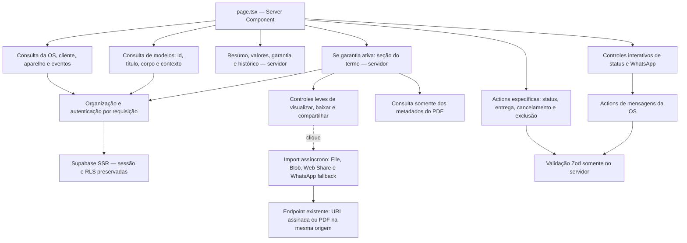

# Otimização do detalhe de manutenção — 23/11/2026

A otimização reduziu o chunk inicial de desenvolvimento de `/manutencoes/[id]`
em **67,4%**, manteve a página no servidor e preservou as funcionalidades.
O teste de compilação ampliada permaneceu vivo, sem `spawn UNKNOWN`,
`ERR_MEMORY_ALLOCATION_FAILED` ou falha de alocação do cache Webpack.
**A abertura autenticada de uma OS real no navegador ainda precisa ser homologada.**

## Auditoria realizada antes das alterações

O ponto de partida incluiu todas as alterações locais que já existiam no projeto,
inclusive o termo de garantia e o perfil low-memory. Elas foram preservadas.
Não foram alterados banco, migrations, Supabase remoto, dependências, heap,
configuração do Webpack, tema ou versões de Next/React por esta tarefa.

Foram rastreados os imports locais de runtime diretos e transitivos do detalhe,
desconsiderando imports exclusivamente de tipos, além dos layouts, tema,
navegação, autenticação e proxy. O grafo local inicial tinha **34 arquivos e
135.348 bytes de fonte**. Esse número não inclui os arquivos internos de
`node_modules` e não representa o tamanho de um bundle de produção.

### Sobrecargas encontradas

1. **Um caminho de Zod para o navegador comprovado no artefato compilado.**
   `CustomWhatsAppMessageForm` importava o schema administrativo de mensagens
   somente para obter rótulos de contexto. O chunk inicial continha 17 definições
   de módulos Zod, incluindo seus mapas de desenvolvimento.
2. **Dois módulos amplos de Server Actions:** manutenção, com 1.243 linhas, e
   mensagens, com 751 linhas. A tela de detalhe alcançava também cadastro,
   manutenção rápida, validação de clientes, métricas e administração de modelos.
   Eles eram código de servidor, não execução integral dessas rotinas no client.
3. **Um caminho estático para os helpers de compartilhamento.** File/Blob,
   download, verificação de Web Share e fallback eram importados ao carregar
   os controles, embora a preparação do PDF já acontecesse somente no clique.
4. **Leituras repetidas de identidade, aprovação e membership**, sem memoização
   durante a renderização, e histórico de eventos sem limite explícito.

A sobrecarga evitável mais clara foi Zod no client. A causa exata do
`spawn UNKNOWN` e da falha nativa de alocação relatados pelo usuário não foi
reproduzida nem confirmada por perfil de heap. O ambiente tem cerca de 3.975 MiB
de RAM; pressão de memória do conjunto de processos continua sendo uma hipótese,
não uma causa única comprovada.

### Componentes e dependências revisados

| Área | Resultado |
| --- | --- |
| Página, resumo do cliente/aparelho, valores, status visual e timeline | Já eram Server Components e continuam assim |
| `DeleteMaintenanceButton` | Client necessário: confirmação, evento e `useActionState` |
| `MaintenanceStatusControls` | Client necessário: três formulários com `useActionState` |
| `WhatsAppButton` | Client necessário: popup, formulário e estado da action |
| `CustomWhatsAppMessageForm` | Client necessário: seleção, prévia, estado e eventos; removido o import de schema |
| `whatsapp-controls.tsx` | Client necessário: refs, popup, Clipboard, estados e eventos |
| `WarrantyDocumentControls` | Client necessário: preparação e compartilhamento; helpers agora assíncronos |
| Tema e navegação globais | Três Client Components adicionais: provider, toggle e navegação; usam contexto/store, eventos e `usePathname` |
| Edição | Formulário completo permanece exclusivamente em `/manutencoes/[id]/editar`; o detalhe usa link |
| Modais | Não havia modal pesado oculto que justificasse outra divisão |
| PDF/Storage | Nenhuma biblioteca de geração de PDF; nenhum formulário de upload ou action administrativa de Configurações importado pelo detalhe |
| WhatsApp | Helpers específicos de telefone/URL/interpolação; sem dependência de estoque, campanhas ou telas de mensagens |
| Barrels | Nenhum barrel amplo encontrado para remover; constantes compartilhadas já usam subcaminhos |
| Ícones | Imports nomeados de Lucide; otimização já incluída nos padrões do Next 16.2.9 instalado |
| Datas | Preservados `Intl`, helpers próprios, datas civis e regras de garantia; sem nova biblioteca |
| Proxy | Nenhuma consulta específica do detalhe; sessão/aprovação mantidas e membership somente no redirecionamento de `/` ou `/login` |

**Conversões de Client para Server: zero.** Os seis módulos Client do detalhe
tinham interação real. Não houve fragmentação da UI; a divisão foi nos módulos
de leitura, ações, tipos e constantes, que tinham motivos concretos de compilação.

## Alterações implementadas

- O detalhe importa consultas `server-only` e actions específicas de manutenção
  e WhatsApp. Os arquivos antigos conservam funções `async` de compatibilidade
  para as demais telas; a compilação real do Next validou essas fronteiras.
- As actions de status/exclusão passaram a um módulo de 258 linhas; as actions
  operacionais/personalizadas da OS, a um módulo de 348 linhas. O detalhe deixa
  de alcançar os schemas completos de cadastro de manutenção e de clientes.
- Constantes de contexto e DTO de mensagens foram separados da validação Zod.
  Tipos compartilhados não dependem de módulos de actions em runtime.
- Há **um import assíncrono por interação**, em `WarrantyDocumentControls`, para
  os helpers de compartilhamento. O indicador `Preparando...` cobre carregamento
  e preparação. Não foi usado `ssr:false`. Visualizar e baixar continuam disponíveis
  como links, sem esperar esse chunk.
- O compartilhamento conserva o segundo clique para `navigator.share`, cancelamento
  recuperável, download alternativo e WhatsApp com anexo manual. Não envia mensagens
  automaticamente nem marca o termo físico como assinado.
- Garantia desativada não renderiza a seção/controles nem consulta metadados.
  O controle leve ainda é uma referência estática da rota; o código de compartilhamento
  fica fora do chunk inicial. Não se afirma que a condição elimina toda compilação
  da seção. Mensagens personalizadas vazias têm estado vazio renderizado no servidor.
- O cache de identidade/aprovação/organização usa `React.cache`, restrito à requisição
  de renderização. Não há cache global de dados ou permissões entre usuários.
  O proxy e as novas requisições de actions mantêm suas verificações.

## Consultas e payload

Contagens abaixo são derivadas dos caminhos de código para uma renderização
autenticada bem-sucedida, com garantia ativa. Não são uma captura de tráfego
de uma sessão real. O teste com o cache real do React confirmou deduplicação e
isolamento de duas organizações concorrentes e bloqueio de sessões inválidas.

| Consulta/caminho | Antes | Depois |
| --- | --- | --- |
| `auth.getUser`, somando layout, admin, página e filhos | Até 7 | 1 durante a renderização |
| RPC de aprovação da conta | Até 7 | 1 durante a renderização |
| Membership + organização | Até 4 | 1 durante a renderização |
| Verificação de platform admin | 1 | 1 |
| OS + cliente + aparelho, em uma consulta com relações | 1 | 1; campos explícitos preservados |
| Eventos | 1 sem paginação explícita | 1, até 51 registros para exibir 50 e detectar próxima página |
| Modelos personalizados | 1, 11 campos por modelo | 1, 4 campos por modelo |
| Metadados do documento | 1 se garantia ativa | 1 se garantia ativa; select explícito de 3 campos preservado |
| Storage/PDF na entrada | 0 | 0; endpoint acessado somente ao usar o documento |

Nesse caminho completo, são até **23 chamadas de leitura/RPC antes e 8 depois**
na renderização; as duas verificações independentes do proxy ficam fora dessa
contagem e continuam existindo. Sem garantia, o caminho passa de até 19 para 7.
Esses totais pressupõem a mesma composição de componentes e não são promessa
de latência ou contagem em todos os fluxos de autenticação/erro.

OS e eventos agora começam em paralelo depois de obter a organização autenticada.
Modelos, leitura da OS/eventos e contexto da página também são aguardados juntos.
Não foram paralelizadas mutações ou operações dependentes de resultados anteriores.
O histórico continua filtrado por organização e OS; uma OS ausente/excluída não
devolve eventos ao chamador. Ordenação por data e ID estabiliza empates.

O histórico usa `?historico=2#historico`, com links de anteriores/mais recentes,
sem descartar acesso aos eventos antigos. O teste percorreu 121 eventos em três
páginas, sem perda ou duplicação. Não há `COUNT` de todo o histórico nem milhares
de eventos serializados de uma vez.

O DTO enviado ao formulário Client contém `id`, `title`, `body` e `context`:
**7 campos administrativos a menos por modelo** (63,6% menos campos, não
necessariamente 63,6% menos bytes, pois o corpo da mensagem é variável).
Os demais controles já recebiam IDs, status e strings pequenos; a OS completa
permanece no servidor. Não foram removidos campos visíveis ou valores usados
pela edição, entrega, garantia, cliente ou aparelho.

## Medições locais

| Medida | Antes | Depois |
| --- | --- | --- |
| Fonte local transitiva da rota | 135.348 bytes / 34 arquivos | 85.294 bytes / 37 arquivos: **37% menos fonte alcançada** |
| Módulos locais no caminho estático Client | 13 | 10 |
| Chunk dev `static/chunks/app/(dashboard)/manutencoes/[id]/page.js` | 1.419.265 bytes | 462.666 bytes: **67,4% menor** |
| Definições de módulos nesse chunk | 53 | 33 |
| Definições Zod nesse chunk | 17 | 0 |
| Helpers de compartilhamento nesse chunk | Presentes | Ausentes; chunk solicitado no clique |
| Primeira compilação do detalhe observada no log | 26,8 s | 14,2 s |
| Requisição de diagnóstico correspondente | 27,87 s | 14,97 s |
| Preparação do servidor | Cerca de 2,5 s | Cerca de 2 s |

Os bytes incluem código e mapas de desenvolvimento; não representam transferência
gzip nem bundle de produção. Os caches de disco não foram isolados/limpos entre
as execuções, portanto os tempos não constituem benchmark frio controlado nem
permitem atribuir todo o ganho observado ao código.

### Memória

| Amostra do processo principal | Working set | Memória privada comprometida |
| --- | --- | --- |
| Antes, após compilar o detalhe | 423 MiB | 1.335 MiB |
| Depois, após compilar o detalhe | 514 MiB | 675 MiB |
| Depois, após sequência ampliada + edição + mensagens | 835 MiB | 2.284 MiB |

São amostras pontuais, sujeitas a GC, paginação e processos auxiliares; não são
picos nem soma de todo o ambiente. **Não foi demonstrada redução uniforme de RAM
residente.** O old space continua em 1.536 MiB por processo; memória nativa,
buffers e outras regiões podem elevar o comprometimento além desse limite.
Não foi recomendado aumento de heap com base nessas amostras.

### Webpack cache e sequência de compilação

Mantido o cache filesystem do Next 16.2.9: no código instalado, dev já usa
`maxMemoryGenerations: 0` e compressão gzip, além do gerenciamento de memória
do próprio Next. O erro de pack não foi reproduzido nesta validação; não houve
motivo medido para desligar ou substituir o cache. Os arquivos de cache somavam
cerca de 64,3 MiB antes e 84,1 MiB depois da sequência ampliada, que compilou mais
rotas; esses tamanhos não são uma comparação equivalente de carga nem RAM usada.

Comando usado: `pnpm.cmd --filter web dev:low-memory --hostname 127.0.0.1`.
É o mesmo perfil solicitado; `.cmd` evita limitações da política de PowerShell.

| Sequência após correção e recompilação | Tempo total aproximado | Resultado |
| --- | --- | --- |
| `/dashboard` | 4,47 s | Compilou |
| `/manutencoes` | 2,93 s | Compilou |
| `/manutencoes/[id]` | 3,52 s | Recompilou |
| `/clientes` | 2,35 s | Compilou |
| `/estoque` | 1,77 s | Compilou |
| `/configuracoes` | 2,24 s | Compilou |
| Retorno a `/manutencoes/[id]` | 0,94 s | Processo vivo |
| `/manutencoes/[id]/editar` | 6,62 s | Compilou |
| `/mensagens` | 2,78 s | Compilou |

**Limite do teste:** não havia acesso a navegador autenticado; o host de acesso
ao navegador estava indisponível. GETs anônimos mantiveram 307 para login.
Para compilar as entradas protegidas sem mudar autenticação, foram feitos POSTs
de diagnóstico com uma Server Action deliberadamente inexistente e UUID fictício.
Eles terminaram em **404 esperado**, com `Failed to find Server Action`, sem
executar uma mutação. Esses 404 não são uma abertura bem-sucedida de OS, teste
visual, hidratação ou navegação autenticada. Não houve falha de alocação/cache ou
`spawn UNKNOWN` na sequência final. O servidor de teste foi encerrado ao terminar.

## Validação automatizada

| Verificação | Resultado |
| --- | --- |
| `pnpm lint` | Passou |
| `pnpm typecheck` | Passou |
| `node --test --test-concurrency=1 apps/web/tests/*.test.cjs` | 130 passaram, incluindo quatro novos testes de detalhe |
| Testes SQL de manutenção, termo de garantia e solicitações de conta | 53 passaram em PGlite isolado; sem acesso ao banco remoto |
| `pnpm build` | Passou com Turbopack padrão; compilação em 18 s, TypeScript em 17,9 s e todas as páginas geradas |
| `git diff --check` | Passou |

Os testes web cobrem criação/edição e preços, entrega por formulário/status/atalho,
`final_price = estimated_price` somente quando o final está ausente, preservação
de zero e valores existentes, concorrência, garantia e expiração, termo assinado,
roles e isolamento de documentos, visualizar/baixar, preparo de arquivo,
Web Share/cancelamento/fallback, mensagem/telefone do WhatsApp, clientes,
autenticação, aprovação e proxy. O teste do cache usa a implementação real de
`React.cache` com contextos de requisição separados.

São verificações automatizadas com fronteiras externas simuladas e testes de
SQL isolados; não substituem clicar nos fluxos no navegador/dispositivo real.

## Arquivos desta tarefa

A lista distingue a otimização das alterações que já existiam em README,
configuração, estoque, formulário de manutenção, termo e migrations.
Os arquivos antigos de garantia que já estavam sem commit foram preservados;
somente seus controles compartilhados foram modificados nesta tarefa.

- `apps/web/src/app/(dashboard)/manutencoes/actions.ts` (alterado).
- `apps/web/src/app/(dashboard)/manutencoes/delete-maintenance-button.tsx` (alterado).
- `apps/web/src/app/(dashboard)/manutencoes/maintenance-relations.ts` (alterado).
- `apps/web/src/app/(dashboard)/manutencoes/maintenance-status-controls.tsx` (alterado).
- `apps/web/src/app/(dashboard)/manutencoes/maintenance-timeline.tsx` (alterado).
- `apps/web/src/app/(dashboard)/manutencoes/[id]/page.tsx` (alterado).
- `apps/web/src/app/(dashboard)/mensagens/actions.ts` (alterado).
- `apps/web/src/app/(dashboard)/mensagens/custom-whatsapp-message-form.tsx` (alterado).
- `apps/web/src/app/(dashboard)/mensagens/whatsapp-button.tsx` (alterado).
- `apps/web/src/app/(dashboard)/mensagens/whatsapp-controls.tsx` (alterado).
- `apps/web/src/components/warranty-document-controls.tsx` (alterado).
- `apps/web/src/lib/auth/platform-admin.ts` (alterado).
- `apps/web/src/lib/auth/queries.ts` (alterado).
- `apps/web/src/lib/maintenance/action-context.ts` (novo).
- `apps/web/src/lib/maintenance/detail-actions.ts` (novo).
- `apps/web/src/lib/maintenance/detail-queries.ts` (novo).
- `apps/web/src/lib/maintenance/types.ts` (novo).
- `apps/web/src/lib/messages/action-context.ts` (novo).
- `apps/web/src/lib/messages/custom-template.ts` (novo).
- `apps/web/src/lib/messages/maintenance-actions.ts` (novo).
- `apps/web/src/lib/messages/maintenance-queries.ts` (novo).
- `apps/web/src/lib/messages/whatsapp.ts` (alterado).
- `apps/web/src/lib/organization/queries.ts` (alterado).
- `apps/web/src/lib/validations/custom-message-template.schema.ts` (alterado).
- `apps/web/src/lib/validations/maintenance-status.schema.ts` (novo).
- `apps/web/src/lib/validations/maintenance.schema.ts` (alterado).
- `apps/web/tests/fase-14a.test.cjs` (alterado).
- `apps/web/tests/fase-14a2.test.cjs` (alterado).
- `apps/web/tests/maintenance-details.test.cjs` (novo).
- `apps/web/tests/maintenance-pricing.test.cjs` (alterado).
- `apps/web/tests/quick-maintenance-address.test.cjs` (alterado).

Este relatório também é um arquivo novo da tarefa.

## Checklist manual e liberação da homologação

1. Iniciar `pnpm --filter web dev:low-memory` no PC de 4 GB e entrar normalmente.
2. Abrir `/dashboard` → `/manutencoes` → uma OS real de homologação; registrar
   tempo de compilação e confirmar cliente, telefone, aparelho/IMEI, defeito,
   diagnóstico, previsão, valores, observações e histórico.
3. Abrir a edição e conferir os campos. Em OS apropriada para teste, alterar
   status e entregar; verificar preço final ausente herdando estimado, final já
   informado preservado e zero preservado. Não modificar OS operacional apenas
   para validar essa regra.
4. Testar OS com/sem garantia, termo físico assinado/não assinado, período,
   início, validade e observações. O PDF informativo deve continuar compartilhável
   antes da assinatura, enquanto o aviso de garantia mantém sua regra de assinatura.
5. Visualizar e baixar o PDF; compartilhar em dispositivo compatível; cancelar e
   tentar novamente; testar download + WhatsApp manual no fallback. Conferir
   mensagens operacionais/personalizadas, popup bloqueado e copiar mensagem.
6. Se houver mais de 50 eventos, percorrer anteriores e voltar aos recentes.
7. Navegar `/clientes` → `/estoque` → `/configuracoes` → a mesma OS, confirmar
   que o processo continua vivo e verificar os três erros reportados e o tema.

**Pode retomar a homologação do Termo de Garantia:** sim, para executar esse
checklist. A base técnica e o build passaram. A estabilidade autenticada no PC
de 4 GB e o Web Share real continuam pendentes; o critério completo de sucesso
não está certificado somente pela compilação de diagnóstico.

Não houve commit ou push. O commit depende da confirmação solicitada pelo usuário
depois do teste local: “Você já testou a otimização da tela de manutenção no seu
PC de 4 GB e deseja que eu faça o commit?”

## Referências técnicas

- [React.cache — cache invalidado a cada requisição](https://react.dev/reference/react/cache).
- [Next.js — redução de dependências e memória](https://nextjs.org/docs/app/guides/memory-usage).
- [Webpack — opções de cache](https://webpack.js.org/configuration/cache/).

As configurações efetivas foram verificadas também no Next 16.2.9 instalado,
sem aplicar opções de uma versão diferente por suposição.
